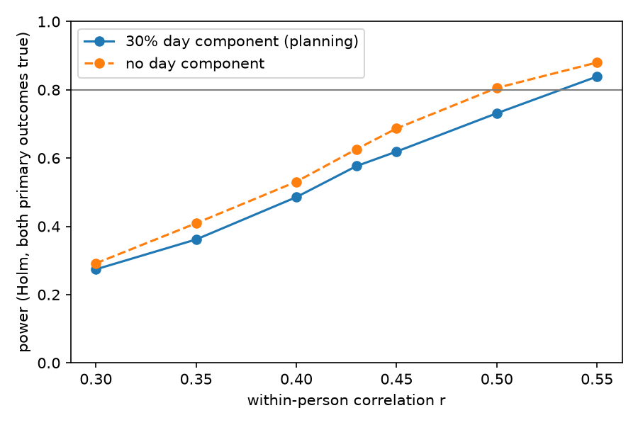

# MindBench: Does naturally varying sleep, or time of day, change attention and memory in one person?

Bharg Patel. A preregistered within-person (N = 1) study with a browser battery.

**Status.** No data have been analysed yet: every result below is pending. This file is generated from `docs/writeup/paper_template.md` by `analysis/python/scripts/build_paper.py`; do not edit `paper.md` by hand. Every number outside a design constant comes from a script output (see "How the numbers are produced" at the end).

## Introduction

Short-term total sleep deprivation impairs working memory, attention and short-term recall in laboratory studies (Lim & Dinges, 2010). Those studies induce large changes in sleep. This project asks a smaller, everyday question about one person: does the ordinary night-to-night variation in how long he sleeps, or the time of day, change how he performs on a short battery of attention and memory tasks?

The question is deliberately modest. Natural sleep variation is probably much smaller than experimentally induced sleep loss, one person cannot support general claims, and only large within-person effects are detectable with the planned number of sessions (see Power). A null result is likely and is an acceptable outcome of the study.

## Methods

### Design

An observational, intensive within-person (N = 1) longitudinal study. The participant, the researcher, completed the battery twice a day (morning and evening) for 21 calendar days, 42 confirmatory sessions (study sessions 3-44). Sleep was observed and logged, never restricted or changed. Each session began with a short questionnaire: hours slept the previous night, bed and wake time, sleepiness, caffeine and device.

### Participant and ethics

The researcher is the only participant. This is a personal, preregistered self-experiment. No institutional review board review has been obtained, and no institutional approval or oversight is claimed. No formal pilot study was run; one or two smoke-test sessions on the deployed site only confirmed that saving worked and are excluded from the analysis. Consequently the design was not tested with other people, there is no qualitative component, and none is claimed.

### Tasks

The battery has five short browser tasks (jsPsych): a contrast-detection staircase with a yes/no signal-detection block (Levitt, 1971), Posner spatial cueing (Posner, 1980), a Stroop task, a 2-back working-memory task, and serial-position free recall (Murdock, 1962). Task parameters are documented design choices (`docs/design/battery.md`), not literature values, except the staircase rule.

### Outcomes

Two primary outcomes were chosen before data collection: **P1**, 2-back d' (log-linear corrected), and **P2**, the proportion of words recalled. Secondary and exploratory outcomes are **S1** Stroop interference, **S2** Posner validity effect, **S3** contrast threshold, **S4** yes/no d' and criterion, and **S5** other measures (`docs/design/scoring.md`). Trials slower than 2,000 ms and sessions failing the preregistered exclusion rules are removed in code (`exclusions.py`) before any analysis.

### Preregistration

The registration is at [PENDING: registration.url]. Code, tasks, analysis scripts and design documents are at https://github.com/Bhargp08/MindBench. The frozen design documents are cited by the registration.

### Analysis

**H1 (sleep, confirmatory).** A linear mixed model fitted by REML: sleep (centered), session number (linear and logarithmic) and a PM indicator, a random intercept for day, and AR(1) residuals over calendar slots so that missed sessions leave gaps. Sleep is tested with a t test on degrees of freedom equal to the included days minus five. **H2 (time of day, confirmatory).** A two-sided paired t test of PM minus AM over days with both sessions, with a BCa bootstrap interval over whole days (10,000 resamples). Alpha is .05, two-sided, with a Holm correction over the two primary outcomes. A significant H1 result in the wrong direction is not supported.

**Exploratory analyses.** A Bayesian version of the H1 model (PyMC) with weakly informative priors and approximate leave-one-out comparison on one-step-ahead predictive densities; drift-diffusion models (PyDDM) asking whether sleep or time of day changes drift rate or boundary separation, compared by BIC; test-retest reliability by ICC (Shrout & Fleiss, 1979) with split-half; EZ-diffusion (Wagenmakers et al., 2007) as a sanity check. These never decide H1 or H2. Their limits are stated in `docs/design/bayes.md`, `ddm.md` and `reliability.md`.

### Power

Simulated power for the mixed model with 42 sessions, a day component of 30% of the residual variance, and a Holm correction over both primary outcomes (2,000 simulations): 0.58 at a within-person correlation of 0.43 and 0.27 at 0.30. Eighty percent power needs a correlation of about 0.53. The study can therefore reliably detect only large within-person effects.

## Results

No data have been analysed yet: every result below is pending. Results appear here only as they are produced by the analysis scripts; the tables are assembled by `mindbench/synthesis.py` from those outputs.

### Confirmatory results

#### H1: sleep (confirmatory)

| ID | Analysis | Tier | Frequentist | Bayesian | DDM | Reliability | Decision | Status | Sources agree |
|---|---|---|---|---|---|---|---|---|---|
| H1:P1 | H1 sleep -> 2-back d' (P1) | confirmatory | pending | pending | n/a | n/a | pending | not yet run | incomplete |
| H1:P2 | H1 sleep -> free-recall proportion (P2) | confirmatory | pending | pending | n/a | n/a | pending | not yet run | incomplete |

#### H2: time of day (confirmatory)

| ID | Analysis | Tier | Frequentist | Bayesian | DDM | Reliability | Decision | Status | Sources agree |
|---|---|---|---|---|---|---|---|---|---|
| H2:P1 | H2 PM - AM on 2-back d' (P1) | confirmatory | pending | n/a | n/a | n/a | pending | not yet run | incomplete |
| H2:P2 | H2 PM - AM on recall proportion (P2) | confirmatory | pending | n/a | n/a | n/a | pending | not yet run | incomplete |

### Exploratory results

Everything below is exploratory or descriptive and is never used to claim support for H1 or H2.

#### H3: mechanism, drift-diffusion (exploratory)

| ID | Analysis | Tier | Frequentist | Bayesian | DDM | Reliability | Decision | Status | Sources agree |
|---|---|---|---|---|---|---|---|---|---|
| H3:S1 | H3 mechanism, Stroop (drift vs boundary) | exploratory | n/a | n/a | pending | n/a | pending | not yet run | incomplete |
| H3:S2 | H3 mechanism, Posner (drift vs boundary) | exploratory | n/a | n/a | pending | n/a | pending | not yet run | incomplete |

#### Secondary and exploratory outcomes S1-S5

| ID | Analysis | Tier | Frequentist | Bayesian | DDM | Reliability | Decision | Status | Sources agree |
|---|---|---|---|---|---|---|---|---|---|
| S1 | S1 Stroop interference | exploratory | pending | n/a | n/a | n/a | pending | not yet run | incomplete |
| S2 | S2 Posner validity effect | exploratory | pending | n/a | n/a | n/a | pending | not yet run | incomplete |
| S3 | S3 contrast threshold | exploratory | pending | n/a | n/a | n/a | pending | not yet run | incomplete |
| S4 | S4 yes/no d' and criterion c | exploratory | pending | n/a | n/a | n/a | pending | not yet run | incomplete |
| S5 | S5 other measures | exploratory | pending | n/a | n/a | n/a | pending | not yet run | incomplete |

#### Manipulation checks (descriptive)

| ID | Analysis | Tier | Frequentist | Bayesian | DDM | Reliability | Decision | Status | Sources agree |
|---|---|---|---|---|---|---|---|---|---|
| MC:S1 | Manipulation check: Stroop interference present | descriptive | pending | n/a | n/a | n/a | pending | not yet run | incomplete |
| MC:S2 | Manipulation check: Posner validity effect present | descriptive | pending | n/a | n/a | n/a | pending | not yet run | incomplete |
| MC:SERIAL | Manipulation check: serial-position curve | descriptive | pending | n/a | n/a | n/a | pending | not yet run | incomplete |

#### Reliability (exploratory)

| ID | Analysis | Tier | Frequentist | Bayesian | DDM | Reliability | Decision | Status | Sources agree |
|---|---|---|---|---|---|---|---|---|---|
| REL | Test-retest reliability (ICC, split-half) | exploratory | n/a | n/a | n/a | pending | pending | not yet run | incomplete |

## Deviations from preregistration

There were no deviations from the preregistration.

Changes to the original build plan made before registration (not deviations from the registration, but they shape the study):

- **S1:** MB-13: 10 self-pilot sessions, a think-aloud study with 2-3 friends, post-task interview and strategy survey with qualitative coding (COGS 13) -> **No formal pilot.** 1-2 smoke-test sessions on the deployed site, only to confirm saving works (study sessions 1-2, `is_pilot = 1`, excluded from analysis) (Nov 18, 2026).
- **S2:** Word pool for 52 sessions x 40 words (10 pilot + 42 confirmatory) -> Requirement is **42 confirmatory x 40 = 1,680 words** (1,760 with 2 smoke-test sessions). The 2,080-word pool is kept; 320 words (session slots 45-52) are spare (Nov 18, 2026).
- **S3:** `is_pilot` for the first 10 sessions -> `is_pilot` for the first 2 sessions (default cutoff 2) (Nov 18, 2026).
- **S4:** DataPipe writes raw data to OSF -> Google Drive via DataPipe; OSF Registries for the prereg, Zenodo for open data (OSF Projects are being retired) (Nov 17, 2026).
- **S5:** MB-01 consent form for every participant -> Consent form deferred while Bharg is the only participant (structure lint stays active) (Nov 17, 2026).
- **S6:** MB-02 literature review with expected effect sizes and sleep literature -> Slimmed to a table of canonical task parameters; effect-size and sleep-literature review deferred (Nov 17, 2026).
- **S7:** 5 primary outcomes -> 2 primary outcomes (2-back d', recall proportion), chosen from Lim & Dinges (2010) Table 2; the rest secondary/exploratory (Nov 17, 2026).
- **S8:** Plain mirrored Latin square; contrast keys 1/2 and Y/N -> Zigzag-based balanced square with an AM/PM-balanced session map; F/J keys for every two-choice response; practice blocks added (Nov 18, 2026).

## Limitations

- One person: nothing here generalizes beyond him.
- Sleep varies naturally and is self-reported, not measured by actigraphy; sleep, day and time of day are not randomized.
- Practice effects and time-of-day confounds within a day are only modelled, not removed.
- Task parameters are design choices; recall lists are length-matched but not frequency-matched; stimulus sizes are in pixels and not physically calibrated.
- The pooled drift-diffusion fits ignore between-session variability, so model-comparison differences are optimistic; the Bayesian likelihood comparison is approximate under dependence.
- Power was simulated, not derived from pilot data, and assumes a linear effect and normal errors; missed sessions lower it.
- No institutional review board review: this is a self-experiment, not approved research.

## Data and code availability

Code, tasks and analysis scripts: https://github.com/Bhargp08/MindBench. De-identified data and analysis outputs are intended for release on Zenodo after the study; raw data stay private.

## Use of AI tools

An AI coding assistant wrote the code, tests and design documents, and a second AI tool reviewed them. The researcher made the design decisions and approved every change. The wording is to be set by the researcher, as in the registration.

## How the numbers are produced

Power: `analysis/python/scripts/power_mixed_report.py` writes `docs/design/power_mixed_results.json`. The figure: `analysis/python/scripts/writeup_figures.py`. Tables and deviations: `mindbench/synthesis.py` from `deviations.md` and the analysis results. Build: `analysis/python/scripts/build_paper.py`. A test (`test_writeup.py`) fails if any other number appears in the text.

## References

- Levitt, H. (1971). Transformed up-down methods in psychoacoustics. Journal of the Acoustical Society of America, 49(2B), 467-477. [bibliographic details not verified]
- Lim, J., & Dinges, D. F. (2010). A meta-analysis of the impact of short-term sleep deprivation on cognitive variables. Psychological Bulletin, 136(3), 375-389.
- Murdock, B. B. (1962). The serial position effect of free recall. Journal of Experimental Psychology, 64(5), 482-488.
- Posner, M. I. (1980). Orienting of attention. Quarterly Journal of Experimental Psychology, 32(1), 3-25.
- Shrout, P. E., & Fleiss, J. L. (1979). Intraclass correlations: Uses in assessing rater reliability. Psychological Bulletin, 86(2), 420-428. [bibliographic details not verified]
- Wagenmakers, E.-J., van der Maas, H. L. J., & Grasman, R. P. P. P. (2007). An EZ-diffusion model for response time and accuracy. Psychonomic Bulletin & Review, 14(1), 3-22. [bibliographic details not verified]
