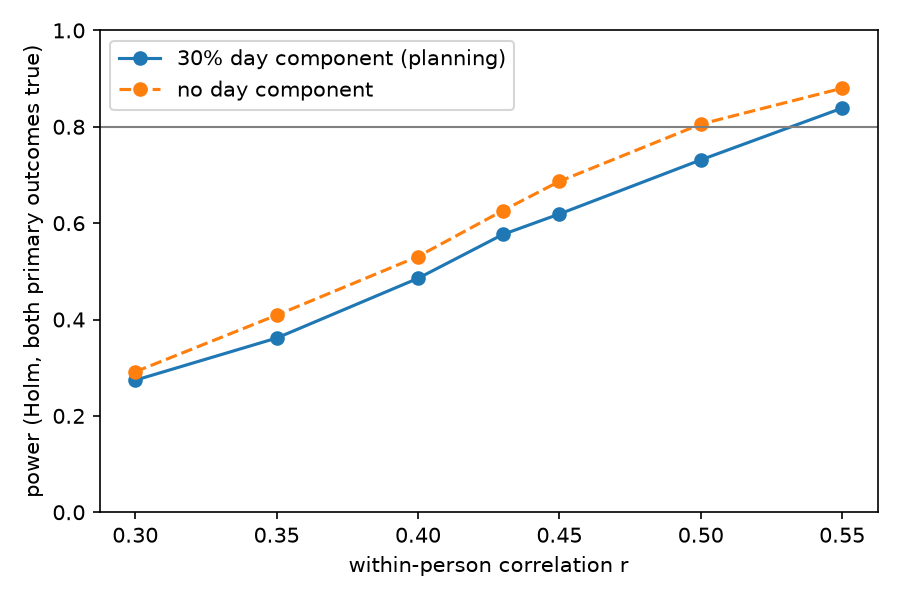

# MindBench: Does naturally varying sleep, or time of day, change attention and memory in one person?

Bharg Patel. A preregistered within-person (N = 1) study with a browser battery.

**Status.** {{status.note}} This file is generated from `docs/writeup/paper_template.md` by `analysis/python/scripts/build_paper.py`; do not edit `paper.md` by hand. Every number outside a design constant comes from a script output (see "How the numbers are produced" at the end).

## Introduction

Short-term total sleep deprivation impairs working memory, attention and short-term recall in laboratory studies [@limdinges2010]. Those studies induce large changes in sleep. This project asks a smaller, everyday question about one person: does the ordinary night-to-night variation in how long he sleeps, or the time of day, change how he performs on a short battery of attention and memory tasks?

The question is deliberately modest. Natural sleep variation is probably much smaller than experimentally induced sleep loss, one person cannot support general claims, and only large within-person effects are detectable with the planned number of sessions (see Power). A null result is likely and is an acceptable outcome of the study.

## Methods

### Design

An observational, intensive within-person (N = 1) longitudinal study. The participant, the researcher, completed the battery twice a day (morning and evening) for 21 calendar days, 42 confirmatory sessions (study sessions 3-44). Sleep was observed and logged, never restricted or changed. Each session began with a short questionnaire: hours slept the previous night, bed and wake time, sleepiness, caffeine and device.

### Participant and ethics

The researcher is the only participant. This is a personal, preregistered self-experiment. No institutional review board review has been obtained, and no institutional approval or oversight is claimed. No formal pilot study was run; one or two smoke-test sessions on the deployed site only confirmed that saving worked and are excluded from the analysis. Consequently the design was not tested with other people, there is no qualitative component, and none is claimed.

### Tasks

The battery has five short browser tasks (jsPsych): a contrast-detection staircase with a yes/no signal-detection block [@levitt1971], Posner spatial cueing [@posner1980], a Stroop task, a 2-back working-memory task, and serial-position free recall [@murdock1962]. Task parameters are documented design choices (`docs/design/battery.md`), not literature values, except the staircase rule.

### Outcomes

Two primary outcomes were chosen before data collection: **P1**, 2-back d' (log-linear corrected), and **P2**, the proportion of words recalled. Secondary and exploratory outcomes are **S1** Stroop interference, **S2** Posner validity effect, **S3** contrast threshold, **S4** yes/no d' and criterion, and **S5** other measures (`docs/design/scoring.md`). Trials slower than 2,000 ms and sessions failing the preregistered exclusion rules are removed in code (`exclusions.py`) before any analysis.

### Preregistration

The registration is at {{registration.url}}. Code, tasks, analysis scripts and design documents are at https://github.com/Bhargp08/MindBench. The frozen design documents are cited by the registration.

### Analysis

**H1 (sleep, confirmatory).** A linear mixed model fitted by REML: sleep (centered), session number (linear and logarithmic) and a PM indicator, a random intercept for day, and AR(1) residuals over calendar slots so that missed sessions leave gaps. Sleep is tested with a t test on degrees of freedom equal to the included days minus five. **H2 (time of day, confirmatory).** A two-sided paired t test of PM minus AM over days with both sessions, with a BCa bootstrap interval over whole days (10,000 resamples). Alpha is .05, two-sided, with a Holm correction over the two primary outcomes. A significant H1 result in the wrong direction is not supported.

**Exploratory analyses.** A Bayesian version of the H1 model (PyMC) with weakly informative priors and approximate leave-one-out comparison on one-step-ahead predictive densities; drift-diffusion models (PyDDM) asking whether sleep or time of day changes drift rate or boundary separation, compared by BIC; test-retest reliability by ICC [@shrout1979] with split-half; EZ-diffusion [@wagenmakers2007] as a sanity check. These never decide H1 or H2. Their limits are stated in `docs/design/bayes.md`, `ddm.md` and `reliability.md`.

### Power

Simulated power for the mixed model with 42 sessions, a day component of {{power.day_share}} of the residual variance, and a Holm correction over both primary outcomes ({{power.sims}} simulations): {{power.holm_r43}} at a within-person correlation of {{power.r_high}} and {{power.holm_r30}} at {{power.r_low}}. Eighty percent power needs a correlation of about {{power.detectable_r}}. The study can therefore reliably detect only large within-person effects.

## Results

{{status.note}} Results appear here only as they are produced by the analysis scripts; the tables are assembled by `mindbench/synthesis.py` from those outputs.

### Confirmatory results

{{table.confirmatory}}

### Exploratory results

Everything below is exploratory or descriptive and is never used to claim support for H1 or H2.

{{table.exploratory}}

## Deviations from preregistration

{{section.deviations}}

## Limitations

- One person: nothing here generalizes beyond him.
- Sleep varies naturally and is self-reported, not measured by actigraphy; sleep, day and time of day are not randomized.
- Practice effects and time-of-day confounds within a day are only modelled, not removed.
- Task parameters are design choices; recall lists are length-matched but not frequency-matched; stimulus sizes are in pixels and not physically calibrated.
- The pooled drift-diffusion fits ignore between-session variability, so model-comparison differences are optimistic; the Bayesian likelihood comparison is approximate under dependence.
- Power was simulated, not derived from pilot data, and assumes a linear effect and normal errors; missed sessions lower it.
- No institutional review board review: this is a self-experiment, not approved research.

## Data and code availability

Code, tasks and analysis scripts: https://github.com/Bhargp08/MindBench. De-identified data and analysis outputs are intended for release on Zenodo after the study; raw data stay private.

## Use of AI tools

An AI coding assistant wrote the code, tests and design documents, and a second AI tool reviewed them. The researcher made the design decisions and approved every change. The wording is to be set by the researcher, as in the registration.

## How the numbers are produced

Power: `analysis/python/scripts/power_mixed_report.py` writes `docs/design/power_mixed_results.json`. The figure: `analysis/python/scripts/writeup_figures.py`. Tables and deviations: `mindbench/synthesis.py` from `deviations.md` and the analysis results. Build: `analysis/python/scripts/build_paper.py`. A test (`test_writeup.py`) fails if any other number appears in the text.

## References

{{references}}
